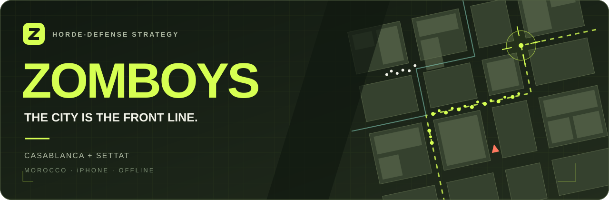
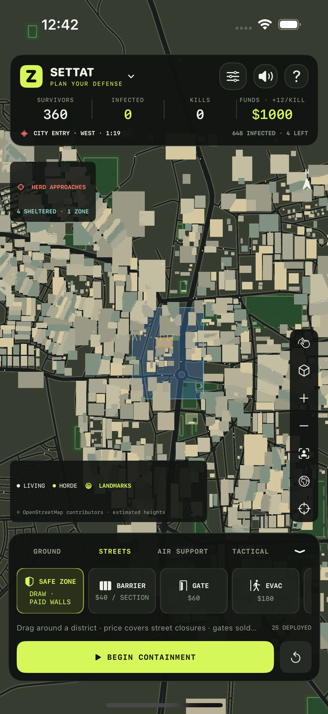
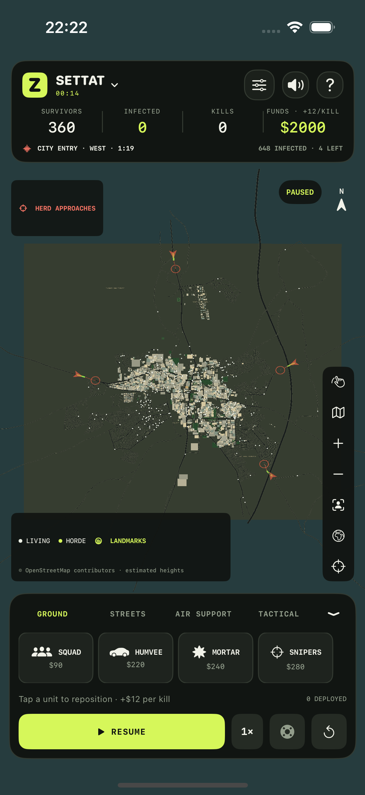
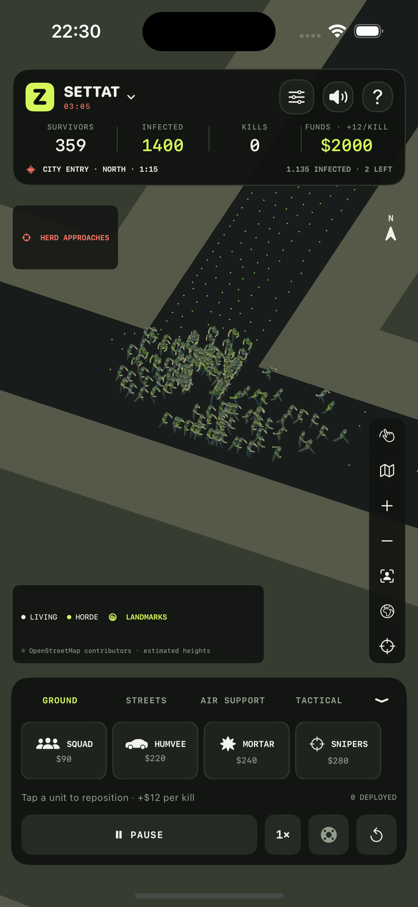

<p align="center">
  
</p>

<h1 align="center">Plan the perimeter. Hold the streets.</h1>

<p align="center">
  <strong>Every civilian counts.</strong><br>
  A native iPhone horde-defense strategy game set in Casablanca and Settat, Morocco.
</p>

<p align="center">
  <strong>iOS 17+</strong> · <strong>SwiftUI + SceneKit</strong> · <strong>Offline maps</strong> · <strong>Built in Xcode</strong>
</p>

<p align="center">
  <a href="#the-operation">Gameplay</a> ·
  <a href="#two-cities-one-mission">Cities</a> ·
  <a href="#run-in-xcode">Run in Xcode</a> ·
  <a href="Screenshots/Zomboys-v8-herd-motion.mp4">Motion preview</a> ·
  <a href="docs/GameGuide.md">Field guide</a>
</p>

---

## The operation

The streets are still full of people. The herds are on their way. You have a limited budget and time to prepare.

Draw barricades, position your forces, and give civilians a route out. When containment begins, watch the infection spread through real street networks. Pause to rethink a failing perimeter, reposition a Humvee, or call in air support. Clear the infected and save as many people as possible.

**Plan → Contain → Adapt → Evacuate → Try a better strategy.**

<table>
  <tr>
    <th width="33%">Fortify a district</th>
    <th width="33%">Read the whole city</th>
    <th width="33%">Meet the herd</th>
  </tr>
  <tr>
    <td></td>
    <td></td>
    <td></td>
  </tr>
</table>

<p align="center"><sub>Actual iPhone Simulator captures. Safe-zone view: V7. City overview and moving herd: V8.</sub></p>

<p align="center"><a href="Screenshots/Zomboys-v8-herd-motion.mp4"><strong>▶ Watch the herd motion preview</strong></a></p>

## Command the response

| Your decision | What it changes |
| :--- | :--- |
| **Build the perimeter** | Draw street barricades with finite health. Enclose safe zones, add civilian gates, and keep evacuation routes open. |
| **Position your forces** | Spread rifle squads, patrol with armed Humvees, place rooftop snipers, and lob mortar shells over buildings. Direct fire needs a clear sightline. |
| **Call heavy support** | Retarget an AC-130 orbit, line up a four-bomb B-2 pass, or send an A-10 through a directional GAU-8 strafe—with its BRRRT. |
| **Make every blast count** | Mines, remote C4, mortars, and air strikes damage buildings and civilians too. Destroyed structures leave rubble and open sightlines. |
| **Guide the crowd** | Civilians learn evacuation locations locally, share that knowledge, and follow nearby people. Infected pursue visible prey, pack into streets, and press against walls. |
| **Learn from each attempt** | Pause, change speed, retry the same seed, or roll a new outbreak. Survival grades reward better rescues; specialization points can be reassigned during planning. |

**Money comes from kills: $12 per infected.** There is no passive income. A one-time emergency reserve offers a chance to regroup when the operation deteriorates. Your score puts civilian survival first.

## Two cities. One mission.

| Operation | The battlefield |
| :--- | :--- |
| **Settat** | The compact starting operation: **360 civilians in Exterior Siege**, connected rural approaches, and six original 3D landmarks, including Kasbah Ismailia, Sidi Loghlimi Mosque, and Hassan I University. |
| **Casablanca** | A larger citywide operation: **720 civilians in Exterior Siege**, the Atlantic coastline, roughly **50,000 building footprints**, and original interpretations of Hassan II Mosque, Twin Center, Morocco Mall, and more. |

Both cities use bundled OpenStreetMap streets and building footprints. Pan across the city, switch between overhead planning and a tilted 3D view, or follow an approaching herd. Distant people appear as compact dots; nearby crowds in the tilted view use articulated bodies and blended walking and running poses.

Choose **Exterior Siege** for assembled herds marching in from outside the city with randomized arrival times. Choose **City Outbreak** to contain a concealed interior infection across expanding districts, carrying surviving paid defenses into the next stage.

## Run in Xcode

**Requirements:** a Mac with Xcode 16.2 or later, plus an iOS 17+ iPhone Simulator or iPhone.

```sh
git clone https://github.com/HMZ-E/Zomboys.git
cd Zomboys
open Zomboys.xcodeproj
```

1. Select the **Zomboys** scheme.
2. Choose an iPhone Simulator or your connected iPhone.
3. Press **⌘R**. On a physical iPhone, first choose your Apple development team under **Signing & Capabilities**.

Maps and audio are bundled. **No API keys, map downloads, or runtime package setup are needed.**

## Explore the project

| Start here | What you’ll find |
| :--- | :--- |
| [Game & development guide](docs/GameGuide.md) | Controls, unit prices, aircraft rules, sound design, project structure, and the full verification commands. |
| [Movement & animation validation](docs/V8MotionValidation.md) | The latest motion changes, checks, measured scope, and remaining performance limits. |
| [Strategy validation](docs/V7StrategyValidation.md) | Paid containment strategies, civilian behavior, progression, and earlier device measurements. |
| [Reference study](docs/ReferenceChannelStudy.md) | Observed mechanics, timestamped video notes, and how they informed original implementations. |
| [Settat map notes](docs/SettatMapNotes.md) | Map coverage, landmark locations, and modeling assumptions. |

<details>
<summary><strong>Developer build check & source layout</strong></summary>

Build for a generic iOS Simulator destination without signing:

```sh
./scripts/build.sh
```

For a focused motion check, run `./scripts/test-crowd-motion.sh`. The [full verification sequence](docs/GameGuide.md#verification) also covers gameplay, tactical planning, campaign progression, terrain, native rendering, and Simulator interaction flows.

```text
Zomboys/
├── Core/        Simulation, navigation, combat, and progression
├── UI/          SwiftUI commands, SceneKit world, and crowd rendering
├── Audio/       Local sound mixer
└── Resources/   Offline maps and sound assets
Tests/           Executable gameplay and rendering checks
ZomboysUITests/  Native Simulator interaction tests
scripts/         Build, test, and map-import tools
```

</details>

**Project status:** playable development build. See the validation notes for current measurements and known limits.

## Credits & data

Map data © [OpenStreetMap contributors](https://www.openstreetmap.org/copyright), under ODbL 1.0. The bundled derived databases include [Casablanca attribution](Zomboys/Resources/CasablancaMap-LICENSE.txt) and [Settat attribution](Zomboys/Resources/SettatMap-LICENSE.txt). Landmark geometry is an original, approximate interpretation.

The A-10 report uses a public-domain recording; other effects use original procedural sound design. See [audio sources & processing](Zomboys/Resources/Audio/SOURCES.md).

Inspired by the city-containment strategy of **Zombies Aren’t Real**. The [reference study](docs/ReferenceChannelStudy.md) documents the footage reviewed; Zomboys uses original code, models, and animation.

---

<p align="center"><strong>Build a plan. Save the city. Make the next attempt count.</strong></p>
